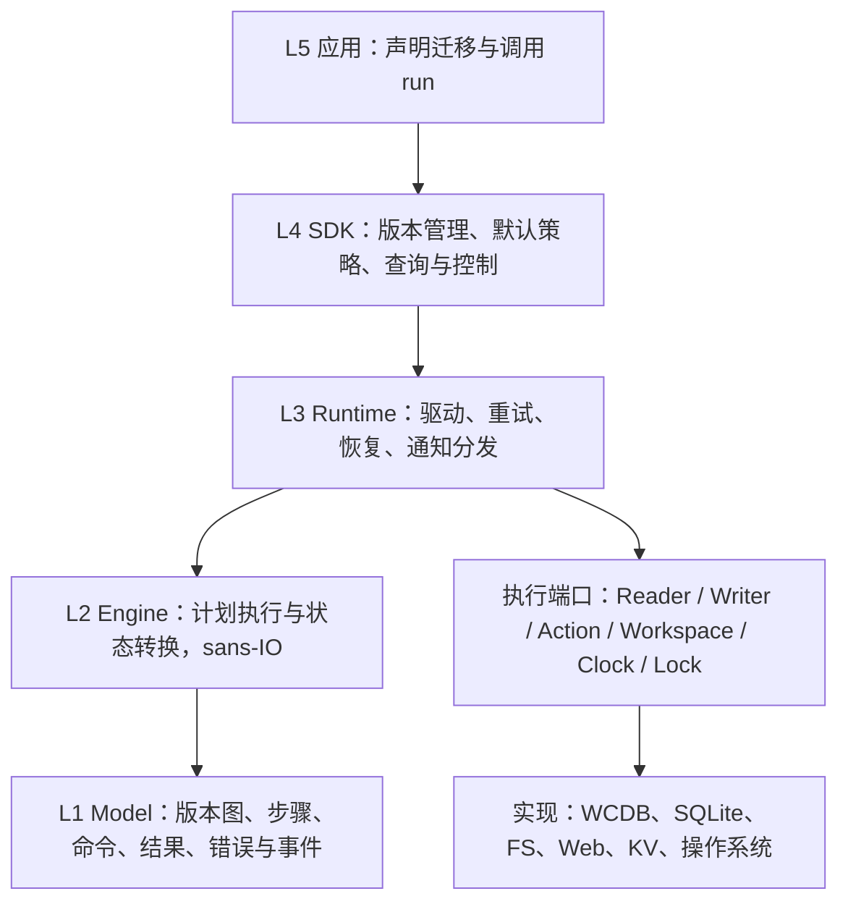

# n2x：统一迁移管线架构草案

状态：分层已落实为 crate 结构、模型与端口契约；执行器尚未实现。本文保留设计推演，
代码是概念示意，实际类型以 [模型契约](model.zh-CN.md)、源码 rustdoc 和
[可编译示例](../crates/n2x-core/examples/manifest.rs) 为准。后续任务见 [实现清单](implementation.zh-CN.md)。

目标：用一套可恢复的管线调度机处理存储迁移、结构升级和数据转换。框架提供标准调度、错误、进度、通知、恢复与运行工作区；应用提供存储适配和业务转换规则。

## 1. 先确定分层



这是职责层次，不要求每层单独一个 crate。

| 层 | 负责 | 主要产物 |
| --- | --- | --- |
| L1 Model | 定义可交换、可验证的协议 | Manifest、Plan、Command、Reply、Error、Notice |
| L2 Engine | 根据输入推进状态、发出下一条命令 | 状态机、恢复判定、调度决定 |
| L3 Runtime | 实际执行命令，把结果交回 Engine | IO 调用、定时、持久化、注册表、事件分发 |
| L4 SDK | 组合默认实现并降低接入成本 | Migrator、RunHandle、Workspace profiles |
| L5 应用 | 定义业务含义 | 迁移路径、转换函数、校验规则、端口绑定 |

Engine 不能读取文件、连接数据库、查询系统时间或调用平台睡眠。需要这些能力时产生 Command，由 Runtime 回传 Reply。时间与随机性若影响决策，也通过显式输入提供。

Runtime 可以有异步 IO。原生与 WASM 使用同一 Engine；Runtime 的平台实现不同。核心协议不要求 Tokio，也不要求所有对象都满足 `Send`。

## 2. 业务模型：版本图外层，顺序管线内层

### 2.1 六个基本概念

| 概念 | 含义 |
| --- | --- |
| Scope | 一次受管理资源的独立实例，例如 `account/42` |
| Revision | 该资源的一个已知状态，例如 `wcdb/3`、`sqlite/1` |
| Manifest | 从一个 Revision 到另一个 Revision 的迁移声明 |
| Step | Manifest 内一个有稳定 ID 的执行步骤 |
| Action | 注册的操作或转换实现，用稳定 ID 和实现修订号引用 |
| Port | 运行时绑定的资源入口，例如 `source`、`target` |

版本图属于一个资源的版本谱系，Scope 区分实际数据实例。两个账号可以复用同一份版本图，但不能共用恢复进度。

Revision 对核心是有意义的稳定标识，核心不解析其中的存储产品名，也不比较字符串或数字大小。`wcdb/1` 与 `sqlite/1` 是不同节点。普通同库升级可以使用 `v1`、`v2`，不必强制包含产品名称。

```text
Scope: account/42

wcdb/3 ── import ──> sqlite/1 ── upgrade ──> sqlite/2
```

数据库身份、文件路径、schema 摘要等属于绑定和校验信息，不应全部塞进版本节点。

### 2.2 Manifest 的结构

```rust
struct Manifest {
    id: ManifestId,
    from: Revision,
    to: Revision,
    steps: Vec<Step>,
}

struct Step {
    id: StepId,
    kind: StepKind,
    policy: StepPolicy,
}

enum StepKind {
    Task(ActionCall),
    Transfer(TransferSpec),
    Check(ActionCall),
}

struct ActionRef {
    id: ActionId,
    revision: u32,
}
```

三种步骤有共同的生命周期、错误和恢复模型，但保留各自必要的协议：

- `Task`：执行一次操作。例如建表、执行 SQL、创建目标目录、发布暂存结果。
- `Transfer`：标准的读取、转换、写入循环，框架负责批次和游标。
- `Check`：只读校验。例如数量、摘要、外键、数据完整性和 schema 条件。

`Task` 和 `Check` 通过 ActionCall 描述具体操作；Transfer 使用标准 Reader/Writer 协议和注册的转换 Action。框架必须知道哪些步骤可改变外部状态，才能正确处理重试。

`Prepare/Data/Finalize` 可以作为展示标签或便捷 builder，不能决定步骤顺序。SQL `after` 应是一个普通 Task，可以插在某张表转换后，也可以放在整条管线最后。

```text
Task：创建 users 表
Transfer：users 导入与转换
Task：为 users 创建索引
Task：创建 messages 表
Transfer：messages 导入与转换
Check：校验全部数据
```

第一版只执行顺序 Step。先把恢复语义做正确，再考虑分区并发或 DAG。版本路径也必须串行提交。

### 2.3 Action 注册与便捷闭包

Manifest 保存 ActionRef 和可持久化参数。Registry 保存实现、支持的协议、恢复能力与配置校验。

闭包可以作为 Rust 层的便捷注册方式，也可以编译到 WASM；限制在于不能自动持久化闭包的执行栈和捕获状态。需要恢复的运行仍必须有稳定 Action ID、实现修订号和显式状态。

Action 内部的 IO 也必须遵守端口协议。纯转换 Action 默认只拿数据与确定的配置，不拿数据库连接。无法表达为纯转换的业务可以拆成 Task，或者后续扩展为有显式子命令的自定义步骤。

### 2.4 计划编译

运行前把版本图编译为一个不可变 Plan：

1. 确认 Scope 的当前 Revision 与目标 Revision。
2. 选择路径；存在多条路径时要求显式 route 或唯一配置的首选路径，不默认取最短路径。
3. 展开 Step，并解析 ActionRef、端口绑定与配置。
4. 校验 Reader、Writer、Task 的能力是否满足恢复策略。
5. 固定 PlanSnapshot 与摘要，再开始产生外部副作用。

摘要包含实际路径、步骤定义、Action 修订号、转换配置、端口资源身份、数据编码与影响结果的策略。密码等连接凭证不进入快照；凭证更新也不应改变资源身份。

恢复时不能悄悄应用改过的 Manifest 或转换函数。摘要不一致应返回 `PLAN_CHANGED`，保留旧运行状态；显式重建计划是另一个管理操作。

版本 graph 可以支持显式跨版本边。降级也必须显式声明，不推断反向操作。第一版建议将普通升级图限制为无环。

## 3. Engine：统一的管线调度机

### 3.1 三条协议通道

```text
Engine ── Command ──> Runtime ──> Port / Action
Engine <── Reply ──── Runtime <── Port / Action
Engine ── Notice ───> Runtime ──> 观察者 / 事件记录

调用方 ── Control ──> Engine
```

- Command 是需要执行的工作。
- Reply 是执行结果，带有原 Command ID。
- Notice 是可观察事实，不能作为业务步骤。
- Control 是暂停、继续、取消等显式控制请求。

前一版所称的 Effect/Event，在这里细化为 Command/Reply/Notice，避免“执行结果”和“通知事件”共用一个 Event 名称。

```rust
struct Transition {
    commands: Vec<Command>,
    notices: Vec<Notice>,
}

impl Engine {
    fn start(&mut self, input: StartInput) -> Transition;
    fn accept(&mut self, reply: Reply) -> Transition;
    fn control(&mut self, control: Control) -> Transition;
}
```

Command 包括读取、转换、写入、调用 Task、校验、提交工作区状态、设置唤醒时间等。Command 用稳定 ID 关联 Reply；旧 attempt 的迟到结果不能误推进新 attempt。

Notice 和已确认进度只有在相应持久化成功后才对外声明。状态机需要显式表达“正在等待持久化确认”。

### 3.2 标准运行状态

```text
Ready -> Running -> Completed
           |
           +-> Waiting -> Running
           +-> Paused -> Running
           +-> NeedsAttention -> Recovering -> Running
           +-> Failed
           +-> Cancelled

进程重开 -> Recovering -> 对账 / 继续 / NeedsAttention
```

`Waiting` 带原因，例如等待重试时间、资源或严格通知队列容量。`NeedsAttention` 表示存在未解决的结果或需要修正的条件，不能当成“目标端完全没有变化”。`Failed` 表示本次执行停止，也不表示自动回滚。

默认在提交边界暂停或取消：停止发出新操作，让当前操作得到明确结果并保存状态。强制中断是单独控制，可能留下待对账操作。取消不会自动删除源数据、目标数据或恢复材料。

### 3.3 共同的执行外壳

每个 Step 都经历：

```text
Ready -> Executing -> Confirming -> Completed
             |
             +-> RetryScheduled
             +-> Reconciling
             +-> NeedsAttention / Failed
```

所有会产生外部副作用的命令都使用同一套 Operation ID、意图记录、结果判定和恢复协议。只读命令也使用统一错误与通知协议，但不要求写入副作用意图日志。

## 4. Transfer：标准数据管线

```text
Reader -> 有界 Batch -> Transform -> WriteSet -> Writer
                                        |
                                 确认后推进 cursor
```

TransferSpec 至少包含：

```rust
struct TransferSpec {
    read: ReadSpec,
    transform: ActionRef,
    write: WriteSpec,
    limits: Limits,
    invalid_data: InvalidDataPolicy,
}
```

### 4.1 Reader 契约

Reader 返回：数据、下一游标、是否结束、源一致性标识。Cursor 是有版本的不透明 token，由 Reader 解释。

稳定排序、快照或高水位边界属于 Reader 的责任。核心不把 offset 当作通用恢复游标。源数据仍会变化时，必须明确选择快照、停写、高水位导出或应用提供的一致性方案；仅仅保存最后一个 ID 不能证明一次完整迁移。

恢复时检查资源身份、游标格式和快照有效性。快照失效需要重新计划或特定恢复流程，不能从不再有效的游标静默继续。

### 4.2 数据与转换契约

核心使用带编码标识的 Envelope，数据可以是内联字节或可重新打开的 BlobRef：

```rust
struct Envelope {
    key: Option<StableKey>,
    codec: CodecId,
    payload: Payload,
}

enum Payload {
    Inline(Bytes),
    Blob(BlobRef),
}
```

Record/Value 可以是可选工具包，不能强制所有数据先转 JSON，否则 BSON 的 Decimal、日期、二进制，以及文件内容可能损失语义。文件适配器可传路径元数据与 BlobRef，不必整文件读入内存。

Transform 支持 1:0、1:1、1:N，也允许批次转换。默认要求同输入与配置产生同输出。时间、随机数或外部查表结果若参与转换，应显式固定输入或保存结果。

第一版不隐式支持多个输出端的原子写入。多目标可以拆成多个 Transfer；相互一致的发布需要额外的明确协议。

### 4.3 WriteSet、提交单位和背压

读取批次不等于外部事务。一个 WriteSet 可以拆成多个有稳定子 ID 的提交单位。

- SQLite 可以把一批记录及去重凭证放进同一个事务。
- 文件迁移通常按文件或分块提交，不能把“文件夹迁移”宣称为一个全局事务。
- 部分提交的输出，必须提供可恢复的逐单位结果；无法判断部分结果的 Writer 不能假装整批失败后直接重试。

只有一个输入批次的全部输出、过滤结果、拒绝记录和状态更新都得到确认后，才能推进该批次 Cursor。1:N 的子操作完成记录也必须可恢复。

默认单批次在途，限制记录数、内联字节数和暂存容量。后续可以增加预读，但 checkpoint 只能推进到连续确认的位置。

### 4.4 源目标相同

原地数据升级也使用 Transfer。Reader 和 Writer 可以绑定同一资源的不同视图、表或字段。

适配器需要声明读写是否影响扫描稳定性。会破坏扫描顺序的更新应改用快照、固定主键集合或暂存表。框架不会自动把任意同库读写包进一个长事务。

## 5. 安全恢复：KV 与输出端共同完成

### 5.1 每个副作用的标准协议

Operation ID 在一次运行内稳定；重试增加 attempt，不更换 Operation ID。请求摘要防止同一个 ID 被用于不同内容。

默认恢复路径：

```text
1. 准备本提交单位的可重放请求
2. 持久化 Intent + 请求或持久引用 + 摘要
3. 执行外部操作
4. 获得明确的 Applied 结果和 Receipt
5. 原子保存 Receipt + checkpoint + 状态增量 + 关键通知记录
6. 确认工作区持久化完成
7. 推进后续工作，异步回收已无引用的暂存材料
```

对于可证明能够重新读取并确定性重建的请求，可以不保存完整输出，但必须保存重建依据与摘要。否则默认暂存已转换的 WriteSet。

大文件或大批次不直接塞进 KV：先持久化 spool，再记录其引用。崩溃后可清理未被引用的孤立 spool；被 pending 操作引用的内容禁止回收。

这里有两个提交系统：输出端提交与工作区提交。它们通常没有共同事务，因此恢复必须处理两者之间的窗口。

| 中断位置 | 重开后的处理 |
| --- | --- |
| Intent 持久化前 | 不允许已经发出对应外部副作用；重新准备即可 |
| Intent 后、输出确认前 | 查询结果或用相同 ID 安全重放 |
| 输出已提交、checkpoint 前 | 通过输出端去重或对账确认，避免重复产生效果 |
| checkpoint 后、通知发送前 | 从事件记录或 outbox 继续通知 |

### 5.2 三类结果

```rust
enum ApplyState {
    NotApplied,
    Applied(Receipt),
    Unknown,
}
```

错误类型和提交确定性是两条独立信息。例如连接超时可能是 NotApplied，也可能是 Unknown。不能因为错误码看起来“可重试”就重复写入。

恢复时允许查询 Applied、NotApplied、仍在执行或 Unknown。只有权威结果才能证明 NotApplied；简单的“暂时没查到”不能推断操作不会随后提交。

### 5.3 输出能力与安全重试

| 能力 | 框架可采用的恢复方式 |
| --- | --- |
| 原子记录 Operation ID 与业务效果 | 使用相同 ID 重试并读取原 Receipt |
| 操作本身幂等 | 用相同请求重放，例如确定键的覆盖写 |
| 可权威查询操作结果 | 先对账，再决定继续或重试 |
| 无上述能力 | Unknown 时进入 NeedsAttention，禁止盲目重放 |

普通事务本身不解决“客户端不知道是否提交”的问题。事务 + 同事务持久化去重标识才提供相应恢复能力。去重保留时间还必须覆盖允许的恢复期限。

Task 同样遵守这张表。DDL、文件 rename、批量写的能力需要逐操作声明，不能只给数据库适配器贴一个笼统的“支持事务”。

默认交付语义是“允许重放的调用 + 已声明的安全恢复能力”。只有满足具体条件的步骤才可以保证业务效果不重复。独立 KV 不能创造跨系统 exactly-once。

### 5.4 工作区失败时

checkpoint 写入或 flush 失败后，不能继续发出后续副作用。保留待恢复状态并返回 Persistence 错误；若连状态都无法保存，API 必须明确返回“持久化未确认”。

开始外部操作前预留意图、确认记录和关键通知的存储预算。空间不足先阻止新操作，不能删除待确认材料以换空间。

## 6. 标准错误系统

### 6.1 错误结构

```rust
struct N2xError {
    code: ErrorCode,
    kind: ErrorKind,
    origin: ErrorOrigin,
    location: ErrorLocation,
    message: String,
    retry_hint: RetryHint,
    details: ErrorDetails,
}

struct OperationFailure {
    error: N2xError,
    apply_state: ApplyState,
}
```

- `code`：稳定的机器错误码，例如 `n2x.plan.changed`。
- `kind`：标准分类，用来制定策略。
- `origin`：Engine、Reader、Writer、Action、Workspace 或 Notification。
- `location`：Scope、Run、Manifest、Step、Operation、attempt，必要时包含记录键。
- `message`：人类描述，不能用于程序分支。
- `retry_hint`：适配器给的建议，可含 retry-after，最终由恢复安全性和策略共同决定。
- `details`：可序列化诊断、原始提供者错误码、脱敏信息。原生错误对象可只在本进程保留。

建议的分类：InvalidPlan、Unsupported、Incompatible、Conflict、SourceChanged、InvalidData、Unavailable、Timeout、Quota、Permission、Integrity、Persistence、Internal。

### 6.2 默认处理矩阵

| 条件 | 默认处理 |
| --- | --- |
| Manifest、绑定或能力不满足 | 外部副作用前失败 |
| 临时不可用且明确未应用 | 有上限的指数退避 |
| 操作结果 Unknown | 优先对账；仅在声明安全时重放 |
| 转换数据无效 | 停止，保留恢复位置 |
| 源身份、快照或计划发生变化 | 停止并要求显式处理 |
| 配额、权限等环境问题 | 暂停或 NeedsAttention，保留现场 |
| 工作区持久化未确认 | 停止新副作用，进入恢复流程 |
| 普通通知回调失败 | 通知诊断，不改变迁移业务结果 |

重试设置包含最大尝试次数、时间预算、退避和可选抖动；到达上限后留下标准 RetryExhausted 错误。超时是执行结果不明的一个可能原因，不能自动等同于服务器取消。

### 6.3 无效数据与隔离

默认 `InvalidDataPolicy::Stop`。可显式允许 Quarantine，但必须保存原记录引用、错误、步骤与来源，并且持久化成功后才能推进 Cursor。

结果报告必须区分成功、允许拒绝记录后的完成、失败或待处理。Check 可以限制拒绝数量或比例。不能用“跳过异常继续”隐藏不完整迁移。

Record 计数要分开表示 read、written、filtered、rejected。因为支持 1:N，written 不一定等于 read。

## 7. 标准通知与查询系统

### 7.1 业务行为与观察分开

`after` 如果需要影响后续执行，就必须是 Task。Observer 回调只观察事实，不能变成管线成功与否的隐式依赖。

标准 Notice 包括：

```text
RunStarted / RunRecovering
StepStarted / StepCompleted
ProgressChanged
RetryScheduled / ReconciliationRequired
RunPaused / RunCancelled
RunCompleted / RunFailed / RunNeedsAttention
```

每条持久事件带 `run_id + sequence`、Scope、Step、类别和 payload；时间由 Runtime 提供。日志输出只是一种接收方式。

### 7.2 两种默认观察接口

| 接口 | 语义 | 用途 |
| --- | --- | --- |
| watch snapshot | 最新状态，可合并中间更新，慢接收者不阻塞迁移 | UI 进度 |
| replay events | 持久化的关键事件，按 sequence 补读 | 重开页面、恢复运行、诊断 |

ProgressChanged 可以按时间或数量合并，不要求每条记录都落盘。恢复后的权威进度来自 checkpoint，而不是 UI 曾看到的最大数值。

有明确总量时提供完成数和估算比例；没有总量时报告已处理数量与当前步骤，不伪造百分比。分别提供“已处理”和“已持久确认”，避免 UI 把未确认写入当成完成。

默认关键事件历史使用有界保留策略，与恢复日志分开。调用方读取已过期 sequence 时返回 EventGap 和当前快照，不能静默遗漏。

### 7.3 可选可靠投递

如果确实需要可靠地把事件投递给外部系统，可以启用 KV outbox：

```text
checkpoint + Notice + outbox 在一次工作区原子提交中保存
                   -> 分发
                   -> 记录订阅者 ACK
```

它提供至少一次投递，接收者按事件 ID 去重。进程崩溃可能造成重发。ACK 游标按订阅者独立保存。

可靠投递与“永远不阻塞且容量有限”无法同时保证。严格 outbox 满时必须在下一个提交单位开始前背压；允许丢弃的订阅者必须显式选择该策略并收到 gap/degraded 信息。默认 UI 观察使用 watch，不承担这类阻塞。

通知诊断不能递归产生无穷的通知错误。内部保留一个独立的诊断出口。

### 7.4 SDK 接口形状

```rust
handle.snapshot();
handle.watch();
handle.events_after(sequence);
handle.pause();
handle.resume();
handle.cancel();
handle.report();
```

暂停、取消、继续是 Control，不通过 Notice 的返回值控制。对 Unknown 的人工处理也应是显式、可审计的 resolution 操作，不能叫普通 retry。

## 8. Workspace：用 KV 封装通用运行管理

### 8.1 对上层暴露语义服务

```text
Workspace
├── State：当前 Revision、资源绑定、迁移边提交记录
├── Runs：PlanSnapshot、运行状态、汇总报告
├── Journal：pending Intent、Receipt、恢复所需材料
├── Checkpoints：Step、Cursor、计数、转换状态增量
├── Events：关键通知历史、可选 outbox 与 ACK
├── Quarantine：被拒绝记录的引用与原因
├── Spool：尚未完成提交所需的持久暂存内容
└── Cache：可丢弃的读取或转换缓存
```

这些是内部命名空间，不需要上层自行设计 KV key。版本记录以 Scope 和资源绑定隔离。业务不能随意写框架保留键。

### 8.2 state_dir 与 cache_dir 必须分开

```text
state_dir/     不可任意删除；影响恢复正确性
  state.kv
  spool/

cache_dir/     可以清空；只影响性能
```

Cursor、Intent、去重依据、尚未提交的 WriteSet 不能放在操作系统可随意清理的缓存中。WASM 用持久存储实现同样的语义，不需要虚构文件路径。

### 8.3 WorkspaceStore 的最小能力

```text
get(key)
commit_atomic(mutations, durability)
scan_prefix(prefix)              // 用于恢复与受控管理
```

WorkspaceStore 是语义端口，`commit_atomic` 必须清楚报告是否达到所请求的持久级别。现有 n2x-kv 可以通过单个 `write` 加 `flush` 适配；Engine 只有收到持久确认后才继续。原子性和持久性不能混为一谈。

大数据使用独立 Blob/Spool 服务。KV 保存状态和引用，不能作为数据库全量导出的默认载体。所有扫描和历史保留都应有边界，避免每个记录生成永久 KV 键。

### 8.4 当前 n2x-kv 的可复用部分与缺口

已具备：字节 KV、原子批次、显式 flush、压缩和崩溃恢复，适合作为本地 Workspace 后端。

需要在 Runtime/适配层补充：

1. 固定的状态编码与 schema 版本；它与用户数据 Revision 分开管理。
2. Workspace 事务语义和 flush 确认屏障。
3. 运行锁、恢复扫描、记录保留与 spool 引用回收。
4. 容量预算与限额，默认 KV 容量不能当作无限日志。
5. 平台持久性说明，包括首次创建、重命名和目录项的持久化。

现有 Store 只防止同一进程重复打开相同路径，没有跨进程锁。第一版建议一个 Workspace 一个活动写者，Native profile 增加独立锁文件的 OS 锁；不要使用可能被 compact 替换的 KV 文件 inode 作为锁依据。Web profile 可以提供合适的跨上下文所有权机制。

KV 没有 CAS，也没有分布式租约，不能用 `get + set` 假装抢锁。以后支持多写者时，需要能阻止旧持有者继续产生效果的 fencing 或等效协议。

MemoryStore 适合测试或明确的临时运行；AnyStore 可作为本进程依赖容器。两者都不能替代可重开恢复的日志。

### 8.5 框架能省去什么

上层不再需要自行实现：

- 当前版本记录与路径选择。
- 运行、步骤、批次的状态表。
- checkpoint、重试、恢复和结果待确认管理。
- 进度聚合、关键通知、恢复后补读与可选 outbox。
- 临时内容的引用、清理、隔离记录与汇总报告。
- 默认错误分类与统一 UI 状态。

框架仍需要上层提供：字段语义、业务校验、无法通用实现的旧系统读取与发布行为。KV 能减少通用实现，不能自动推断业务转换规则。

## 9. 版本推进与“当前版本”的权威来源

每条 Manifest 的全部 Step 完成后，框架执行内置的 AdvanceRevision。普通 Task 不可随意更改框架版本记录。

```text
Steps 全部确认
    -> 原子保存边完成记录 + 当前 Revision + 关键通知
    -> 下一条 Manifest
```

因此 A -> B -> C 在 B -> C 失败时，权威版本仍为 B，同时保留到 C 的部分运行状态。不能谎称资源已经完全是 C，也不能丢掉正在升级的事实。

默认使用 Workspace 作为版本权威。`.initial_revision(...)` 只用于空 Workspace 的首次引导；已有状态与传入值冲突时明确报错。

首次接入已有数据，必须由调用方或 Probe 验证初始版本，不能看到目标文件存在就判断迁移完成。

如果应用要求 SQLite `user_version` 或自己的元数据表作为权威，可提供 StateStore profile：它需要幂等的版本推进与可查询的边完成凭证。Workspace 此时保存执行进度和镜像信息，不再有另一套平等权威。版本端提交后本地日志尚未确认的窗口，也走同一对账协议。

不建议同时独立维护 KV 版本、SQLite 版本和业务版本，然后用“取最大值”消除冲突。绑定身份、Revision 和实际 schema 的不一致需要显式诊断。

框架完成管线不自动等同于应用已切换所有读写流量。需要原子发布数据集的场景，应把发布建模为可恢复 Task 或专用 StateStore 协议。清理旧数据必须有明确策略，并在成功发布和确认保留要求后执行。

## 10. 建议的 crate 组织

第一版保留四个基础 crate，先减少边界而不是继续拆分：

```text
n2x-core
  model/       Revision、Manifest、Step、协议、错误、通知
  plan/        版本图校验与计划编译
  engine/      sans-IO 执行与恢复状态机

n2x-runtime   已替代 n2x-scheduler，目前仅提供端口契约
  ports/       执行接口与能力描述
  registry/    Action 与端口注册
  driver/      Command 分发、计时、控制
  workspace/   状态服务、KV 适配、spool 与保留策略
  observe/     snapshot、事件补读与可选 outbox
  profiles/    native / web / memory 的组合

n2x-kv
  独立的本地存储实现，不依赖 n2x-core

n2x
  SDK、Builder、默认策略、便捷注册和公共 re-export
```

依赖方向：

```text
n2x -> n2x-runtime -> n2x-core
             |
             +-- native feature -> n2x-kv

适配器 -> n2x-runtime 的端口契约及 n2x-core 的协议类型
```

当真实依赖需要隔离时，再增加 `n2x-sqlite`、`n2x-fs`、`n2x-web` 等适配 crate。没有必要先创建 protocol、error、notification、checkpoint 等大量小 crate。

原生文件 KV 当前使用 memmap2 和文件 IO，Web profile 不应无条件链接它。WASM 使用相同的 WorkspaceStore 契约，改由 IndexedDB 等实现。平台特性由 feature/profile 隔离。

## 11. 面向应用的使用形状

以下是 API 草案，重点是接入职责：

```rust
let manifests = vec![
    Manifest::new("import-wcdb", "wcdb/3", "sqlite/1")
        .task("create", call("sqlite.create_schema", 1).on("target"))
        .transfer("users", Transfer::new()
            .read("source", "users")
            .map("user.convert", 2)
            .write("target", "users"))
        .task("indexes", call("sqlite.create_indexes", 1).on("target"))
        .check("verify", call("users.verify", 1)),

    Manifest::new("add-display-name", "sqlite/1", "sqlite/2")
        .task("alter", call("sqlite.add_display_name", 1).on("target"))
        .transfer("backfill", Transfer::new()
            .read("target", "users_without_display_name")
            .map("user.display_name", 1)
            .write("target", "user_display_names"))
        .check("verify", call("display_names.verify", 1)),
];

let migrator = Migrator::builder()
    .manifests(manifests)
    .workspace(Workspace::native(state_dir).cache_dir(cache_dir))
    .port("source", wcdb_adapter)
    .port("target", sqlite_adapter)
    .actions(actions) // 包含上述操作与转换的注册实现
    .build()?;

let handle = migrator.start(
    RunRequest::new("account/42", "sqlite/2")
        .initial_revision("wcdb/3")
)?;

let report = handle.wait().await?;
```

RunRequest 可以在已有运行时自动选择恢复该运行；是否重新创建运行由显式策略决定。`start` 返回的 handle 只是控制句柄，不把状态与某个 UI 页面生命周期绑在一起。

同一套模型的场景对应：

| 场景 | Task | Transfer | Check |
| --- | --- | --- | --- |
| WCDB -> SQLite | 建表、索引 | 旧接口读取与转换后写入 | 数量、键、业务约束 |
| SQLite 升级 | DDL | 回填或重建表 | schema、约束、数据 |
| MongoDB -> SQL | 建表、临时结构、发布 | 文档到行转换 | 键与业务完整性 |
| 文件夹 -> 文件夹 | 准备目标、发布 | 条目与 Blob 流式复制 | 条目清单、摘要 |
| localStorage -> IndexedDB | 创建 store | 键值读取、转换和写入 | 键和值校验 |

## 12. 第一版的范围与验证

必须先完成：顺序计划、三类 Step、稳定操作 ID、状态确定性、Intent/Receipt、checkpoint、版本推进、标准错误、snapshot/事件补读、Native KV Workspace 和一个可验证的假端口。

随后用两条真实路径验证统一程度：文件夹复制，以及 SQLite schema + data 升级。再接 WCDB 和浏览器。

先不实现通用 DAG、分布式调度、全局自动回滚、跨数据库事务或任意执行栈恢复。需要逆向处理时显式提供反向 Manifest 或补偿步骤，并说明它们也可能失败。

实现阶段最重要的验证是故障注入：在 Intent 前后、输出提交前后、工作区提交前后、通知 ACK 前后分别中断，确认恢复不会跳过未确认数据、不会危险重放、不会提前推进 Revision。还需验证未知结果、快照失效、资源绑定变化、KV 满、迟到 Reply 与重复通知。

验收标准：新适配器只实现端口与业务规则，复用相同的计划、调度、恢复、错误和通知流程，不再自行设计一套迁移管理系统。
