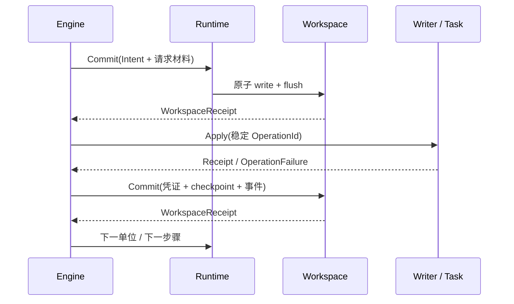

# 实现与接入说明

模型与标准管线已实现。数据库和文件业务适配器只在测试项目中，库提供协议、调度和
工作区基础设施。声明字段见 [模型契约](model.zh-CN.md)，行为示例见
[网页测试项目](../tests/migration-lab/README.md)。

## 1. 实际模块

| 模块 | 责任 |
| --- | --- |
| n2x-core::compiler | 校验声明、选择唯一路径或显式路径、解析能力、生成不可变计划 |
| n2x-core::codec | 递归排序的规范 JSON 与 SHA-256；Encoded 业务字节不变 |
| n2x-core::engine | 单命令在途、Task / Transfer / Check、版本提交、错误恢复与控制 |
| n2x-runtime::Registry | Reader / Writer / Task / Check / Transform 注册与命令执行 |
| n2x-runtime::Migrator | start / tick / run，所有权、恢复验证、查询与通知管理 |
| n2x-runtime::StateWorkspace | 版本、计划、恢复、隔离、报告、通知、订阅与提交去重 |
| n2x-runtime 原生模块 | KvBackend、NativeLock、NativeClock、NativeBlobStore |
| n2x | 模型与上述入口的统一导出 |

## 2. 应用接入顺序

1. 为一组实际资源确定稳定 ScopeId 和 ResourceId。账号数据和工作区不能串用。
2. 声明版本边，每个操作分为 Task、Transfer 或 Check，同版本多个项目顺序放入 steps。
3. 向 Registry 注册所需行为，提供资源绑定、ActionRef 修订号和真实恢复能力。
4. 原生环境用 `Migrator::open_native(directory, manifests, registry)` 组合 KV、锁和时钟。
   其他平台用 `Migrator::new` 注入 Workspace、Clock、Lock；加载任何状态前必须取得锁。
5. `start(RunRequest)` 编译或恢复。initial 仅用于尚未存在的 Scope，不覆盖已有版本。
6. `run().await` 得到报告或标准错误；UI / 宿主事件循环用 `tick().await` 逐条驱动。

完整可编译的装配代码位于 `tests/migration-lab/src/lib.rs` 的 make_migrator。
异步返回值不强制 Send，不绑定 Tokio；原生 KV 和文件实现包含同步 IO，宿主按需放到
专用线程。Web 可选择 `default-features=false, features=["engine"]`，实现平台端口。

## 3. 一条命令的提交边界



外部业务与工作区不假装共享事务。Writer/Task 自己保证幂等、同事务去重或权威查询。
失败明确区分 NotApplied、Applied、Unknown；Unknown 不能简单当作失败后重放。
恢复会比对保存计划、资源身份、行为修订与能力，验证待确认请求和凭证，再递增 epoch。
旧 epoch 回复被拒绝。工作区提交确认失败时保留同一 CommitId，不执行新业务操作。

Transfer 冻结转换结果和有序写入单位，记录 Receipt 连续前缀。全批单位、隔离记录均确认后
才一起推进 cursor、转换状态与统计。重开不会重新生成已经冻结的输出。
读、转换、检查出错会持久失败；副作用支持有界自动重试、指数退避、期限及去重保留期。
每次重新 Apply 前先持久清除上一次的结果判定，恢复时不会将旧 NotApplied 当成新尝试的
结果。人工确认 NotApplied 则先持久保存结论和审计，再经过相同的重试提交边界。
NativeClock 由外部提供时间和唤醒，Engine 本身不睡眠。

## 4. 工作区与版本权威

```text
state_dir/
  workspace.lock    独立锁文件，不随 KV compact 替换
  state.kv          n2x-kv 原子状态与提交收据
  archive/          retire 前写出的 JSONL 运行归档
spool_dir/          可选 NativeBlobStore，显式配置并由适配器使用
cache_dir/          应用自己的可清除缓存，不保存恢复必需材料
```

内置工作区的物理键使用 `n2x/v1/<namespace>/<JSON编码身份>`，避免字符串拼接歧义。
一个 WorkspaceCommit 映射成一次 KV write；Durable 要求 flush 成功。即使前次 write 已成功
而 flush 或回复不明，重放也再次执行持久屏障。CommitId 相同但摘要不同会拒绝。

ScopeState 是权威版本。整条边完成时原子保存版本、RevisionCommit、checkpoint 和事件。
SQL user_version 可以作为业务 Task 更新和 Check 校验；它可能在边提交前短暂领先。
失败、暂停、取消保留 active_run，下一次 start 恢复原运行或报告目标冲突。
取消只停止后续工作，显式 Resume 可以继续，不代表自动回滚。

NativeBlobStore 支持流式追加、持久冻结、范围读取与摘要验证。引用存在时由应用负责保留；
不自动回收 Blob 与 spool 材料。范围读取会扫描摘要，内存有界。默认 KV 为 64 MiB，单值和事务
仍受 n2x-kv 限制；超限返回错误，不拆分原子事务或删除现场。可自行组合带 StoreOptions
的后端。工作区默认每个运行只保留最近 128 条提交收据（`with_commit_retention`），
事件默认每个运行 1000 条、整个工作区 20_000 条（`with_event_budget`），超限返回背压。
已完成运行应在读取或导出报告后调用 `Migrator::retire_run`，回收计划、恢复快照、事件、
隔离记录和提交收据；默认保留报告作为 RunId 墓碑，`keep_report = false` 可一并删除。
原生组合会先把同一批材料写入 `archive/<run>-<hash>.ndjson` 并 fsync，成功后才删除 KV；
归档失败时提交返回错误，KV 现场保持不变。归档文件按运行幂等，重试不会重复写入。
活动、暂停、失败、取消或仍有可靠订阅者的运行保留现场，不会被回收。

归档是 JSONL：第一行是运行头，后续每行是一个被删除的键值。`value` 保留工作区的
JSON 形态，不再拆解业务字段；隔离记录会原样进入归档。

```text
{"format_version":1,"run":...,"scope":...,"current":...,"target":...,"plan":"<hex>","retire_commit":...,"archived_at":...,"entries":N}
{"kind":"plan|recovery|report|events|quarantine|commit-log|commit","key":"n2x/v1/...","value":...}
...
```

## 5. 通知与控制

`snapshot` 返回最近已确认视图，`drain_notices` 取得本执行器确认后的事件。
`events_after(run, after, limit)` 从持久事件按页补读。默认每个运行保留 1000 条，可通过
`StateWorkspace::with_event_limit` 调整；全工作区默认 20_000 条，可通过
`with_event_budget` 调整。过期位置返回带快照的 EventPage::Gap。
事件预算与总收据裁剪都在同一个提交里原子更新；超限不会写入半批事件。

可靠订阅使用：

```text
subscribe(CommitId, NoticeAck { subscriber, run, through_sequence })
    → events_after(run, through_sequence, limit)
    → 消费者处理并按 run + sequence 去重
    → acknowledge(新的 CommitId, 累计 NoticeAck)
    → 重复补读与确认
unsubscribe(CommitId, run, subscriber) 释放历史保护
```

订阅必须在所需历史过期前注册。未确认事件不能被裁剪；满时提交返回
`n2x.notice.backpressure`。消费者 ACK 或显式退订后，可 tick 重试原提交。
通知提交不确定时，调用方重用相同 CommitId 和内容。框架提供持久拉取机制，外部推送
通道由应用实现。通知回调不能充当业务步骤；必需行为声明为 Step。

控制包括 Pause、Resume、Cancel、Resolve。Pause/Cancel 在安全边界生效；未知结果进入
NeedsAttention。Resolve 必须提供明确判断与审计原因；其事件先持久化再继续。
显式 Resume 可为权威 NotApplied 重置一次人工重试预算；普通重开不重置自动重试上限。
Completed 运行拒绝继续、暂停或取消，后续迁移必须创建新运行。

## 6. 错误与版本路径

N2xError 可序列化，包含 code、kind、origin、retry_hint 与定位上下文。
业务操作另带 ApplyState，不通过 message 猜测提交状态。Failed / NeedsAttention 都有持久
RunReport；`Migrator::run` 返回 Err，报告可单独查询。计划错误在副作用前直接返回。

| 情况 | 行为 |
| --- | --- |
| v0 请求 v3 | 解析并顺序执行 v0→v1→v2→v3 |
| 当前已经 v3，再请求 v3 | 空路径完成，不重做业务步骤 |
| v3 请求 v1，无反向边 | n2x.version.rollback_unsupported |
| 两条路径可达目标 | n2x.plan.route_ambiguous，需 Route::Explicit |
| 业务事务明确回滚 | 保留旧权威版本，记录业务错误和 NotApplied |
| 输出提交后进程中断 | 同 ID 安全重放或权威查询，避免重复效果 |
| 未知结果且不能自动核对 | NeedsAttention，等待显式 Resolve |
| 源视图变化、资源换绑或计划变化 | 停止并报告，不静默套用旧游标 |

真正跳过中间版本需要单独声明从当前版本到目标版本的 Manifest，并明确选择路径。
快捷按钮只表示目标选择，不会默默遗漏必要的目录搬迁或建索引步骤。

## 7. 验证覆盖与范围

- 网页测试：逐版执行、直接 v3、同版本多个项目、索引不改行、反向请求、事务回滚后继续。
- 故障恢复：逐命令边界重开、外部提交后 checkpoint 前重开、暂停/取消后继续、源变化停止。
- 核心：路径歧义、旧回复拒绝、未确认版本不可见、未知结果人工核对、有限重试、定时器错误。
- 工作区：提交去重、write 成功/flush 不明、事件 Gap、可靠订阅背压、锁竞争、Blob 完整性。

测试不等同于跨所有文件系统的断电验证；端口恢复保证仍依赖实际适配器契约。
库不实现通用分布式事务、自动逆迁移、后台网络投递或业务数据库端口。
